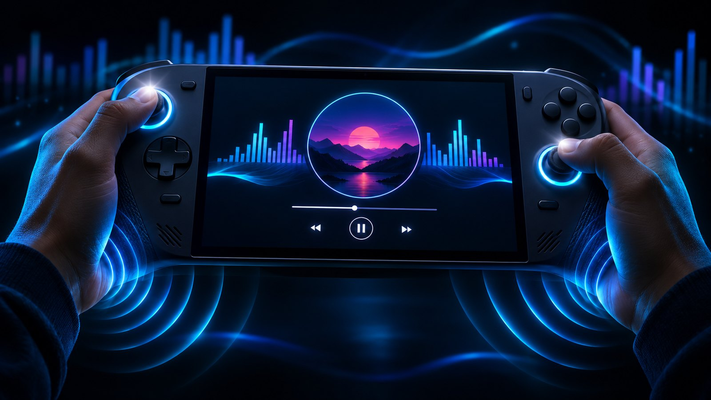
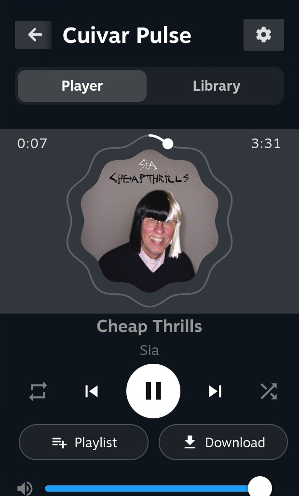
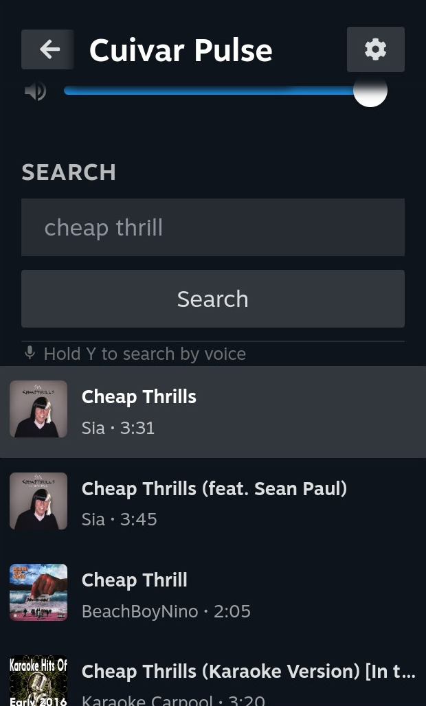
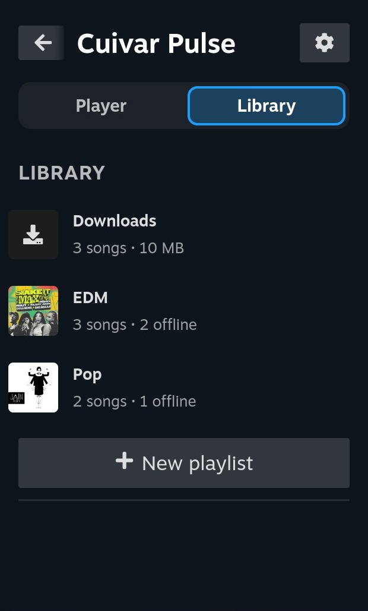
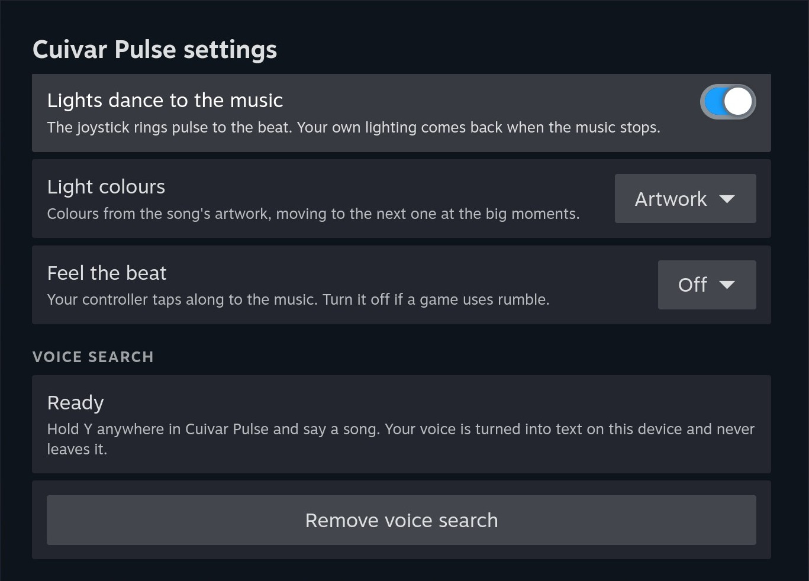
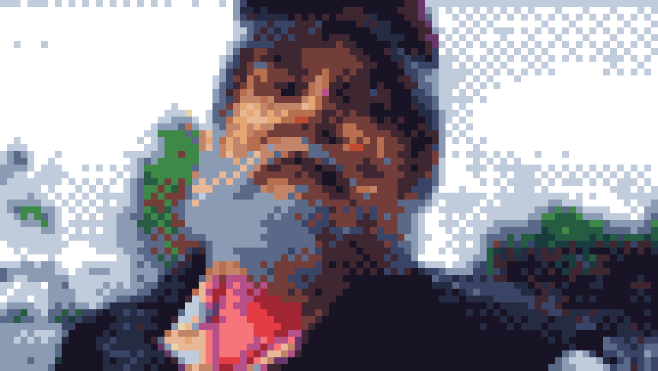
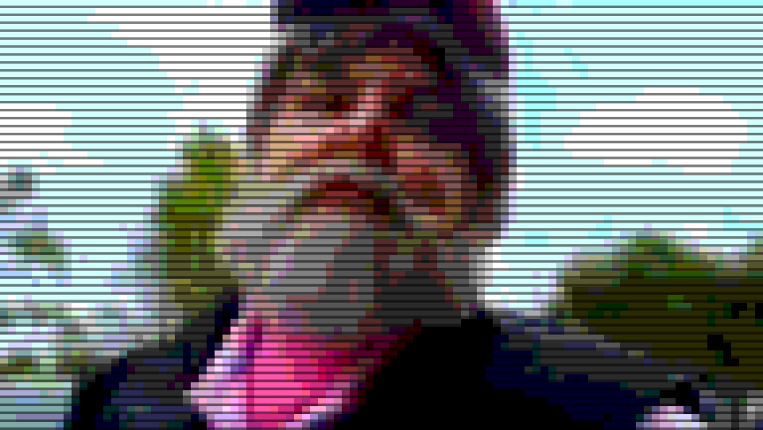

# Cuivar Pulse

**The ad-free music player built for handhelds: your controller lights up and rumbles to the beat.**

Cuivar Pulse is a [Decky Loader](https://decky.xyz) plugin that makes your handheld part of the
music. The joystick lights pulse with every beat, flash white-hot on the big hits and build up
into the drops. **Feel the beat** taps the rumble motors in time with the song, so you feel it in
your hands. Underneath is a full player in the Quick Access Menu that keeps playing while you game.

<p align="center">
  
  <br><sub>The joystick lights on the drop of <i>Cheap Thrills</i> (Legion Go S).</sub>
</p>

<p align="center">
  
  <br><sub>Feel the beat: the rumble motors tap along with the song (illustration).</sub>
</p>

<p align="center">
  
  
  
</p>
<p align="center">
  
</p>

### TV mode

The song's music video as pixel art, fullscreen on the Legion Go S. Here's the same frame of
*Dance Monkey* (Tones And I) in each pixel style (Settings → TV mode → Pixel style):

| Retro (default) | Arcade | Game Boy |
|---|---|---|
|  |  |  |
| 32 classic game colours with a light dither | The video's own colours with CRT scanlines | Four shades of green |

*Shown on the Legion Go S. In-game, the player lives in the Quick Access Menu (`…`).*

## Features

- **Lights that dance to the music** *(Legion Go S)*: the joystick rings pulse on every beat, flash white-hot on the biggest hits, double-flash on drops and build up before the big ones. Colours come from the song's artwork (or its music video in TV mode), a **Rainbow** that speeds up as the song gets intense, or a single colour. Your own lighting comes back when the music stops.
- **Feel the beat** *(handhelds with rumble, off by default)*: **Subtle** taps on the biggest beats and drops; **Strong** taps every beat and hits harder on the drops.
- **In sync with what you hear**, even on Bluetooth headphones: the lights and rumble wait for the audio delay automatically.
- **TV mode.** Switch the player from ♪ to 📺 and the song's music video plays as retro pixel art, in sync with the music, in the panel or fullscreen. Pick Retro, Arcade (CRT scanlines) or Game Boy style. Songs without a real video keep their artwork. Never runs while a game is open.
- **Plays over your games.** Music runs in the background; open the Quick Access Menu (`…`) any time to control it.
- **No ads, no account.** Search songs and artists and play them straight away. When the queue ends, a radio of similar songs keeps it going.
- **Voice search.** Hold **Y**, say a song, let go. Speech is turned into text on your device (offline Whisper model); your voice never leaves it. One-time 135 MB download the first time you use it, removable in Settings.
- **Made for controllers.** Everything works with the D-pad and buttons. Press **X** on any song for options (play next, add to playlist, download).
- **Seek on the disc.** Drag the ring around the artwork to jump through a song, or highlight it and press D-pad **left / right** for −10 s / +10 s.
- **Playlists and offline downloads.** Downloaded songs play without internet. Set a download limit (by songs or storage) in Settings; Cuivar reminds you when you're close and suggests songs you haven't played in 30 days.
- **Separate music volume.** Turn the music down without touching your game's sound.
- **Picks up where you left off.** Queue, position, shuffle and repeat survive restarts.

## Install

**From a URL (easiest):**
1. In Decky's settings, turn on **Developer mode**.
2. Developer → **Install Plugin from URL** and paste:
   ```
   https://github.com/shikamaru2694/CuivarPulse/releases/latest/download/CuivarPulse.zip
   ```
   (Use the direct `.zip` link: the Releases *page* link won't install. This link always gets the newest version.)

**From DeckyHub:** search for *Cuivar Pulse* in [DeckyHub](https://deckyhub.com/plugins/cuivarpulse.html)'s Discover tab.

**From a ZIP:**
1. On your handheld, download `CuivarPulse.zip` from the [Releases](../../releases/latest) page
   (in Desktop Mode, or copy it over to the Downloads folder).
2. In Decky's settings, turn on **Developer mode**.
3. Developer → **Install plugin from ZIP** and pick the file.

Needs SteamOS (or another Linux with PipeWire) and Decky Loader 3.x. Nothing else to install:
playback uses ffmpeg and PipeWire, which SteamOS already has. The first time it starts, Cuivar
Pulse sets up its music engine (about 5 MB, see [What's in the release](#whats-in-the-release)).

## Settings

Open the plugin and press the **⚙** in the title bar.

| Setting | What it does |
|---|---|
| Controller | Music lights on/off and their colours (Artwork, Rainbow, One colour) on devices with ring lights, and *Feel the beat* taps (Off, Subtle, Strong) on devices with rumble. |
| Voice search | Download or remove the offline speech engine (135 MB). |
| TV mode | Pixel style (Retro, Arcade, Game Boy), and whether downloaded songs keep their pixel video for offline. |
| Download limit | Cap offline downloads at 50 / 100 / 200 / 500 songs or 2 / 5 / 10 / 25 GB. Nothing is ever deleted without asking. |
| Region | The country whose YouTube Music catalogue and charts you get. *Automatic* follows your system language. |
| Music engine | The engine's version, and an *Update music engine* button as a backup (it updates itself, see below). |

## Troubleshooting

- **"YouTube is busy right now"**: YouTube is temporarily limiting your internet connection, often after a lot of searching or downloading in a short time. Wait a few hours. Downloaded songs keep working in the meantime.
- **"Couldn't set up the music engine"**: the first launch needs the internet once. Connect and press *Try again*.
- **Songs stop loading after YouTube changes something**: the engine updates itself straight away and retries. If that can't fix it yet, open ⚙ → **Update music engine** later.
- **Lights stuck on a colour**: turn *Controller lights* off and on again, or restart Decky. Your saved lighting is restored automatically at startup.

## Performance and battery

While music plays, Cuivar Pulse uses **about 1–3% of one CPU core** and **about 120 MB of RAM**, measured on a Legion Go S. Music adds roughly **0.5 W**, and the lights and Feel the beat make no measurable difference to battery. TV mode never runs while a game is open.
Full numbers, method and how to measure it yourself: [docs/PERFORMANCE.md](docs/PERFORMANCE.md).

## Privacy

Cuivar Pulse has no account, no analytics and no servers of its own. It talks only to YouTube
Music (search, songs, artwork and TV mode videos) and to GitHub (to download the music engine
and voice search from their official releases, and to check for engine updates once a day).
Voice search listens only while you hold Y, and the recording is turned into text on your device
and never uploaded. Your playlists, downloads and settings stay on your device.

The programs it runs (ffmpeg, PipeWire, yt-dlp) get only the environment variables they need
(paths, language, audio), never the rest of yours, and nothing in Cuivar Pulse reads Steam
login data, SSH keys or browser cookies.

## What's in the release

Every release is built by GitHub from the tagged source code
([.github/workflows/release.yml](.github/workflows/release.yml)), not on anyone's computer.
It's a single `CuivarPulse.zip` (about 0.5 MB) with a `SHA256SUMS` file next to it, and GitHub
signs a [build provenance attestation](https://docs.github.com/actions/security-for-github-actions/using-artifact-attestations)
for it. The ZIP contains only:

| In the ZIP | What it is | Where it comes from |
|---|---|---|
| `plugin.json`, `package.json` | Plugin name, version and description for Decky | This repository |
| `main.py`, `cuivar/*.py` | The plugin's backend (player, library, lights, TV mode, voice search, engine setup) | This repository, as is |
| `dist/index.js` | The panel you see in the Quick Access Menu | Built from `src/` by `npm run build` (Rollup) during the release; readable, not minified |
| `py_modules/ytmusicapi`, `requests`, `urllib3`, `charset_normalizer`, `idna` | Python libraries for YouTube Music search | Unmodified from PyPI (versions in [THIRD-PARTY-NOTICES.md](THIRD-PARTY-NOTICES.md)), committed in this repository |
| `py_modules/certifi/__init__.py` | A few lines pointing HTTPS at the system's certificate store (instead of bundling certificates) | Written for Cuivar Pulse |
| `LICENSE`, `README.md`, `THIRD-PARTY-NOTICES.md` | This documentation | This repository |

No programs, no binaries, no compiled or packed code, and no source maps.

**Downloaded on first launch** (into the plugin's data folder, `~/homebrew/data/CuivarPulse/`), each one checked before use:

| Program | From | Checked against |
|---|---|---|
| yt-dlp: its pure-Python release (readable source, about 3 MB), run with the system's Python | [github.com/yt-dlp/yt-dlp/releases](https://github.com/yt-dlp/yt-dlp/releases) | The `SHA2-256SUMS` file published with that release |
| yt-dlp's official Linux build, *only if the system has no Python 3.10+* | Same | Same |
| QuickJS-ng 0.18.0 (`qjs-linux-x86_64`), the JavaScript engine yt-dlp needs for YouTube | [github.com/quickjs-ng/quickjs/releases](https://github.com/quickjs-ng/quickjs/releases/tag/v0.18.0) | SHA-256 `85ded23b9fabe8c1644fc40a8d2bbdd71157affcbd807359c618cc717ee24d7d`, pinned in [cuivar/tools.py](cuivar/tools.py) |
| Voice search, *only if you turn it on* | [sherpa-onnx releases](https://github.com/k2-fsa/sherpa-onnx/releases) | SHA-256 values pinned in [cuivar/voice.py](cuivar/voice.py) |

yt-dlp is kept current: it checks for a new release once a day, and straight away if YouTube
changes something. Every new version is checked against its published SHA-256, tried on a real
video first, and the previous working version is kept, so an update can't break playback.

**Check a download yourself:**

```sh
sha256sum -c SHA256SUMS                     # the ZIP matches the published checksum
gh attestation verify CuivarPulse.zip --repo shikamaru2694/CuivarPulse   # and was built by this repository's workflow
```

Or rebuild it: in a clone, `npm ci && python scripts/package.py --tag v1.1.0` produces a ZIP
with the **same SHA-256** as the release. Builds are reproducible, on Linux or Windows.

## Build from source

Requires Node.js 18+ and Python 3.

```sh
npm ci
npm run build               # the panel → dist/index.js
python scripts/package.py   # the ZIP → out/CuivarPulse.zip + out/SHA256SUMS
```

`package.py` zips the committed source files plus the built panel, with fixed file dates, so the
same commit gives the same ZIP. Releases are made by pushing a version tag (`git tag v1.1.0 &&
git push --tags`); GitHub builds and publishes them.

Project layout: `main.py` is the Decky backend; `cuivar/` holds the player (ffmpeg → PipeWire),
the download engine and its setup (`tools.py`), library, catalogue, lights, TV mode (`video.py`)
and voice search; `src/` is the React frontend.

## Licence

[GPL-3.0](LICENSE). Third-party software and their licences are listed in
[THIRD-PARTY-NOTICES.md](THIRD-PARTY-NOTICES.md).

Cuivar Pulse is an independent, unofficial project. It is not affiliated with or endorsed by
YouTube, Google, Valve or Lenovo. Use it in line with the terms of the services you access.
