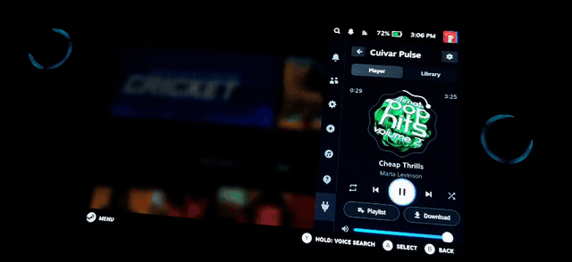

# Cuivar Pulse

**The ad-free music player built for handhelds: your controller lights up and rumbles to the beat.**

Cuivar Pulse is a [Decky Loader](https://decky.xyz) plugin that makes your handheld part of the
music. The joystick lights pulse with every beat, flash white-hot on the big hits and build up
into the drops. **Feel the beat** taps the rumble motors in time with the song, so you feel it in
your hands. Underneath is a full player in the Quick Access Menu that keeps playing while you game.

<p align="center">
  
</p>

<p align="center">
  
  
  
</p>
<p align="center">
  
</p>

*Shown on the Legion Go S. In-game, the player lives in the Quick Access Menu (`…`).*

## Features

- **Lights that dance to the music** *(Legion Go S)*: the joystick rings pulse on every beat, flash white-hot on the biggest hits, double-flash on drops and build up before the big ones. Colours come from the song's artwork, or choose **Energy**, **Rainbow** or a single colour in Settings. Your own lighting comes back when the music stops.
- **Feel the beat** *(handhelds with rumble, off by default)*: **Subtle** taps on the biggest beats and drops; **Strong** taps every beat and hits harder on the drops.
- **In sync with what you hear**, even on Bluetooth headphones: the lights and rumble wait for the audio delay automatically.
- **Plays over your games.** Music runs in the background; open the Quick Access Menu (`…`) any time to control it.
- **No ads, no account.** Search songs and artists and play them straight away. When the queue ends, a radio of similar songs keeps it going.
- **Voice search.** Hold **Y**, say a song, let go. Speech is turned into text on your device (offline Whisper model); your voice never leaves it. One-time 135 MB download the first time you use it, removable in Settings.
- **Made for controllers.** Everything works with the D-pad and buttons. Press **X** on any song for options (play next, add to playlist, download).
- **Seek on the disc.** Drag the ring around the artwork to jump through a song, or highlight it and press D-pad **left / right** for −10 s / +10 s.
- **Playlists and offline downloads.** Downloaded songs play without internet. Set a download limit (by songs or storage) in Settings; Cuivar reminds you when you're close and suggests songs you haven't played in 30 days.
- **Separate music volume.** Turn the music down without touching your game's sound.
- **Picks up where you left off.** Queue, position, shuffle and repeat survive restarts.

## Install

**From a ZIP:**
1. On your handheld, download `CuivarPulse-<version>.zip` from the [Releases](../../releases/latest) page
   (in Desktop Mode, or copy it over to the Downloads folder).
2. In Decky's settings, turn on **Developer mode**.
3. Developer → **Install plugin from ZIP** and pick the file.

**From the Decky store:** coming soon.

Needs SteamOS (or another Linux with PipeWire) and Decky Loader 3.x. Nothing else to install:
playback uses ffmpeg and PipeWire, which SteamOS already has.

## Settings

Open the plugin and press the **⚙** in the title bar.

| Setting | What it does |
|---|---|
| Controller | Music lights on/off and their colours (devices with ring lights), and *Feel the beat* taps (devices with rumble). |
| Download limit | Cap offline downloads at 50 / 100 / 200 / 500 songs or 2 / 5 / 10 / 25 GB. Nothing is ever deleted without asking. |
| Region | The country whose YouTube Music catalogue and charts you get. *Automatic* follows your system language. |
| Music engine | Update the engine (yt-dlp) if songs stop loading after YouTube changes something. |

## Troubleshooting

- **"YouTube is busy right now"**: YouTube is temporarily limiting your internet connection, often after a lot of searching or downloading in a short time. Wait a few hours. Downloaded songs keep working in the meantime.
- **Songs stop loading for everyone**: open ⚙ → **Update music engine**.
- **Lights stuck on a colour**: turn *Controller lights* off and on again, or restart Decky. Your saved lighting is restored automatically at startup.

## Privacy

Cuivar Pulse has no account, no analytics and no servers of its own. It talks only to YouTube
Music (search, songs and artwork) and to GitHub (when you press *Update music engine*, and once
to download voice search). Voice search listens only while you hold Y, and the recording is
turned into text on your device and never uploaded. Your playlists, downloads and settings stay
on your device.

## Build from source

Requires Node.js 18+ and Python 3.

```sh
npm install
npm run build          # frontend → dist/
python scripts/package.py   # release ZIP → out/CuivarPulse-<version>.zip
```

`package.py` downloads yt-dlp and QuickJS from their official releases into `bin/` and checks
their SHA-256 against `package.json` (`remote_binary`). Python libraries are vendored in
`py_modules/`.

Project layout: `main.py` is the Decky backend; `cuivar/` holds the player (ffmpeg → PipeWire),
the download engine, library, catalogue and lights; `src/` is the React frontend.

## Licence

[GPL-3.0](LICENSE). Third-party software and their licences are listed in
[THIRD-PARTY-NOTICES.md](THIRD-PARTY-NOTICES.md).

Cuivar Pulse is an independent, unofficial project. It is not affiliated with or endorsed by
YouTube, Google, Valve or Lenovo. Use it in line with the terms of the services you access.
